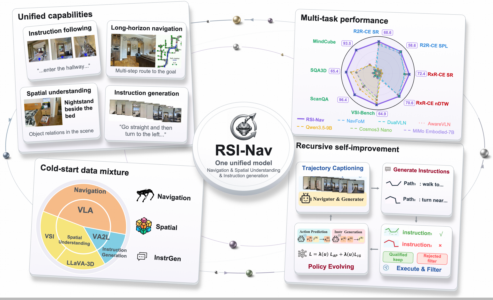
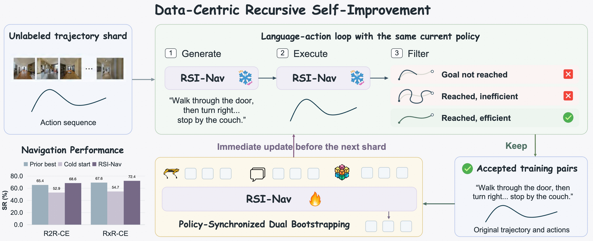

# RSI-Nav: Data-Centric Recursive Self-Improvement for Navigation via Policy-Synchronized Language-Action Dual Bootstrapping

[](http://arxiv.org/abs/2610.15782)
[](https://huggingface.co/papers/2610.15782)

#### [Songze Li](https://scholar.google.com/citations?user=8rBMUD4AAAAJ), [Haoming Gu](https://scholar.google.com/citations?hl=zh-CN&user=Kn2WmqkAAAAJ), [Ziyang Gong](https://cuzyoung.github.io/ZiyangGong.github.io/), [Zhitong Wang](https://github.com/zt-wang19), [Gengze Zhou](https://gengzezhou.github.io/), [Zun Wang](https://zunwang1.github.io/), [Yuhan Zhu](https://zyuhan1999.github.io/), [Tianxiang Jiang](https://scholar.google.com/citations?user=54jmoNYAAAAJ), [Juanzi Li](https://www.cs.tsinghua.edu.cn/info/1111/3487.htm), [Qi Wu](https://researchers.adelaide.edu.au/profile/qi.wu01), [Weinan Zhang](https://homepage.hit.edu.cn/zhangweinan?lang=en), [Yu Qiao](https://scholar.google.com/citations?hl=en&user=gFtI-8QAAAAJ), [Wenwei Zhang](https://zhangwenwei.cn/), [Yi Wang](https://shepnerd.github.io/)



## 🏠 About

**RSI-Nav** is a recursive self-improvement framework for continuous vision-language navigation, built on Qwen3.5-9B. It improves instruction following and generation through iterative instruction generation, navigation verification, and joint training with spatial-data replay.




## 📦 Repository Contents and Release Status

```text
RSI-Nav/
├── qwenvl/
│   ├── data/                 # Dataset registration and multimodal preprocessing
│   └── train/                # Qwen SFT, attention helpers, and training arguments
├── scripts/
│   ├── navigation/           # Distributed SFT launcher
│   └── zero3.json            # DeepSpeed ZeRO-3 configuration
├── rollout/                  # Discrete-to-continuous conversion and RGB rendering
├── evo/                      # Generation, verification, queueing, and model updates
├── eval/Nav/                 # R2R-CE navigation evaluation
├── install/
│   ├── INSTALLATION.md       # Environment and simulator build instructions
│   ├── environment.yml       # Reference Conda environment export
│   └── requirements.txt      # Python package pins with local-path entries removed
└── LICENSE                   # MIT license
```

This repository provides training, trajectory conversion, self-improvement, and R2R-CE evaluation code. Model weights and datasets are prepared separately.

## 🛠 Getting Started

The reference environment uses:

| Component | Version |
| --- | --- |
| Python | 3.11.12 |
| PyTorch / CUDA | 2.7.0+cu128 / 12.8 |
| Transformers | 5.2.0 |
| Habitat-Sim / Habitat-Lab / Habitat-Baselines | 0.3.3 |
| NumPy | 1.26.4 |
| FlashAttention | 2.8.3 |

Follow **[INSTALLATION.md](install/INSTALLATION.md)** for environment setup and simulator installation.

## 📁 Model and Data Preparation

Download [Qwen3.5-9B](https://huggingface.co/Qwen/Qwen3.5-9B), [MP3D](https://niessner.github.io/Matterport/), and [HM3D](https://aihabitat.org/datasets/hm3d/). Prepare navigation data from R2R, RxR, SRDF, EnvDrop, and ScaleVLN, and spatial data from VSI-590K, LLaVA-3D, and MindCube using the layout below.

```text
data/
├── datasets/
│   ├── convert/                  # Data-conversion workspace
│   ├── envdrop/                  # EnvDrop navigation annotations
│   ├── mindcube/                 # MindCube annotations and media
│   ├── r2r/
│   │   ├── json/                 # Qwen-format navigation training JSONL
│   │   └── val_unseen/val_unseen.json.gz
│   ├── rxr/
│   │   └── json/                 # Training annotations only
│   ├── scalevln/
│   ├── scanqa/                   # LLaVA-3D / ScanNet spatial supervision
│   ├── srdf/
│   ├── va2l/                     # Trajectory-to-instruction annotations
│   └── vsi_590k/                 # VSI annotations and VSI-590K media
├── scene/
│   ├── hm3d/
│   └── mp3d/
└── trajectory_data/
    ├── R2R/
    ├── RxR/
    ├── EnvDrop/
    ├── ScaleVLN/
    ├── srdf/
    └── evo_traj/
```

Set annotation and media paths in `qwenvl/data/__init__.py`, scene and episode paths in the Habitat YAML configurations, and replay paths in `evo/evo_utils.py`. The `data/` directory is excluded from Git.

## 🔄 Usage

DE-to-CE conversion, SFT, recursive self-improvement, and evaluation support **multi-node, multi-GPU execution**. Complete [installation](install/INSTALLATION.md), update the paths and job settings in the corresponding scripts, and run commands from the repository root. The `run.sh` submission templates use `rjob`.

### 1. DE → CE

Convert discrete trajectories with `rollout/de2ce.py`, merge the generated episode shards, then render RGB observations with `rollout/get_img_rank.py`. Configure input, output, and scene paths in these files before running:

```bash
python rollout/de2ce.py
python rollout/get_img_rank.py --idx 0
```

### 2. Supervised Fine-Tuning (SFT)

Configure datasets in `qwenvl/data/__init__.py` and training settings in `scripts/navigation/qwen3_5_9b_nav_32.sh`. Submit a multi-node training job with:

```bash
bash scripts/navigation/run.sh
```

### 3. Recursive Self-Improvement (RSI)

Set the initial checkpoint and data paths in `evo/run_8gpu_pilot.sh`, then submit the job:

```bash
bash evo/run.sh
```

### 4. R2R-CE Evaluation

Set the checkpoint and output paths in `eval/Nav/vln_r2r.sh` and dataset paths in `eval/Nav/config/vln_r2r.yaml`. Run the evaluation script on the allocated nodes:

```bash
bash eval/Nav/vln_r2r.sh
```

## 🙋 Questions or Issues

Please [open an issue](https://github.com/OpenGVLab/RSI-Nav/issues) with the command, environment versions, and a minimal error trace. Remove credentials and private infrastructure details from shared logs.

## 🔗 Citation

If you find our work useful in your research, please consider starring 🌟 this repo and cite the following paper:

```bibtex
@article{li2026datacentric,
  title={Data-Centric Recursive Self-Improvement for Navigation via Policy-Synchronized Language-Action Dual Bootstrapping},
  author={Li, Songze and Gu, Haoming and Gong, Ziyang and Wang, Zhitong and Zhou, Gengze and Wang, Zun and Zhu, Yuhan and Jiang, Tianxiang and Li, Juanzi and Wu, Qi and Zhang, Weinan and Qiao, Yu and Zhang, Wenwei and Wang, Yi},
  journal={arXiv preprint arXiv:2610.15782},
  year={2026}
}
```

## 👏 Acknowledgements

We thank the teams behind [Qwen](https://github.com/QwenLM), [Habitat](https://github.com/facebookresearch/habitat-lab), [Matterport3D](https://niessner.github.io/Matterport/), and [VLN-SRDF](https://github.com/wz0919/VLN-SRDF) for making their models, datasets, and code publicly available.
